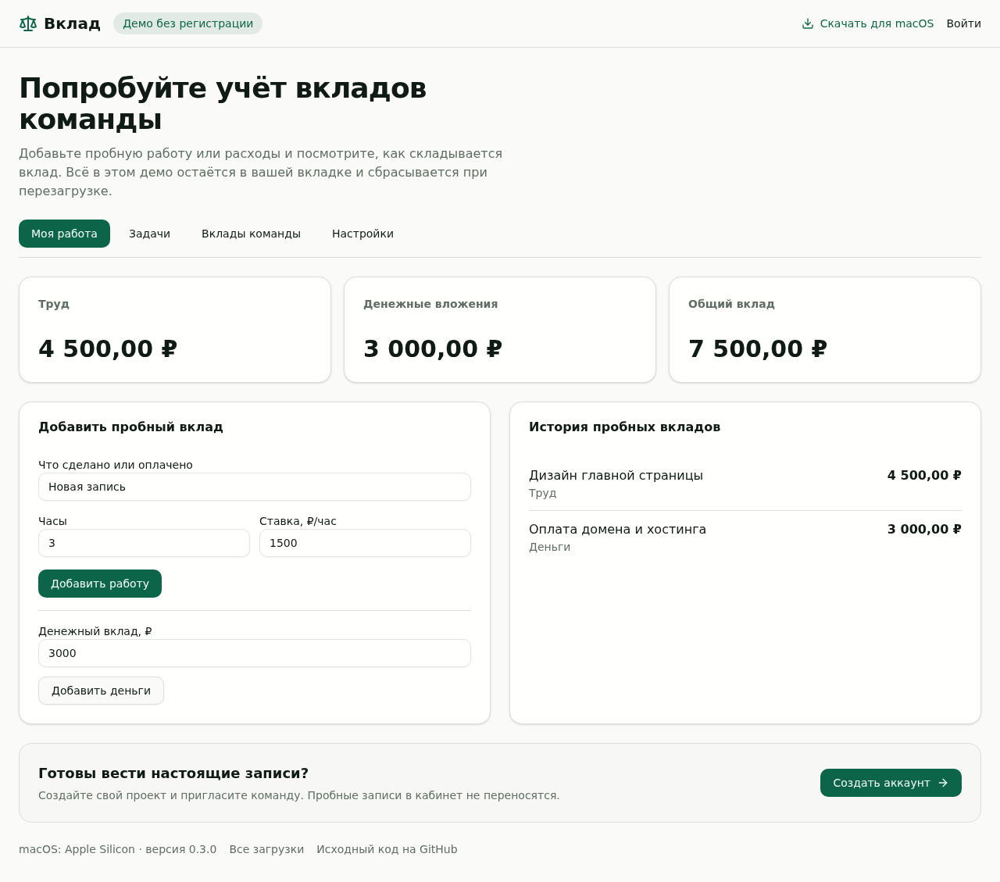
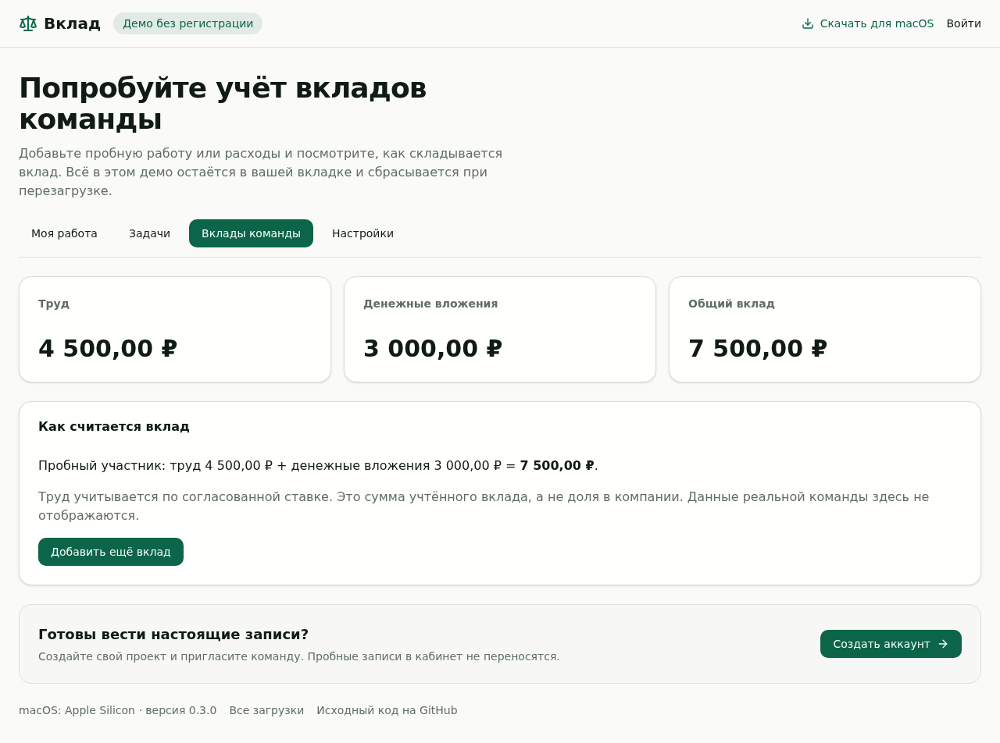

# Вклад

Учёт труда и денежных вложений команды: видно, кто сколько вложил в проект по согласованным ставкам.

**[Открыть сайт и попробовать демо](https://vklad.bezrabotnyi.com/)** · [Скачать для macOS](https://vklad.bezrabotnyi.com/downloads/Vklad-macOS-arm64-v0.3.1.dmg)

- **Работа и деньги вместе.** Задачи, рабочие сессии и расходы складываются в общий вклад.
- **Труд по согласованной ставке.** Учтённые часы переводятся в денежную сумму; вклад не определяет долю в компании.
- **Несколько проектов в одном аккаунте.** Создавайте свой проект, принимайте приглашения в чужие и переключайтесь между ними. Права и записи разделены по проектам.
- **Заполненный демо-кабинет без регистрации.** Посмотрите примеры задач, отчётов и вкладов, затем создайте свой проект.
- **Клиент для Mac.** Локальная запись Screenpipe запускается пользователем и остаётся на его компьютере.

## Начать пользоваться

1. Откройте [демо](https://vklad.bezrabotnyi.com/demo), изучите готовые примеры, добавьте пробную работу или расходы и посмотрите итог.
2. [Создайте аккаунт и свой проект](https://vklad.bezrabotnyi.com/login?register=1). Демо-записи остаются в текущей вкладке до перезагрузки и не переносятся в кабинет.
3. Пригласите команду ссылкой из кабинета. Участники с существующим аккаунтом могут принять приглашение без повторной регистрации.

## Скриншоты

Публичное демо на русском; все записи на снимках — пробные.

**Добавление труда и денежных вложений**



**Общий вклад демонстрационной команды**



## Скачать для Ubuntu

[Загрузить Вклад 0.3.1 для Ubuntu 22.04 / amd64](https://vklad.bezrabotnyi.com/downloads/Vklad-Ubuntu-amd64-v0.3.1.deb)

```sh
sudo apt install ./Vklad-Ubuntu-amd64-v0.3.1.deb
```

Клиент с иконкой и встроенным Screenpipe. Запуск, настоящий захват кадра и остановка проверяются автоматически на отдельном рабочем столе Ubuntu. Запись этой версии рассчитана на X11; [подробности и команда автопроверки](linux/README.md).

## Скачать для macOS

[Загрузить Vklad 0.3.1 для Apple Silicon](https://vklad.bezrabotnyi.com/downloads/Vklad-macOS-arm64-v0.3.1.dmg) · [Все загрузки](https://vklad.bezrabotnyi.com/downloads/)

Откройте образ и перетащите Vklad.app в «Программы». Скачать образ из терминала:

```sh
curl -fLO https://vklad.bezrabotnyi.com/downloads/Vklad-macOS-arm64-v0.3.1.dmg
```

Сборка предназначена для Apple Silicon и не нотарифицирована Apple. Запись экрана требует разрешения macOS и не запускается автоматически. [Возможности и ограничения Mac-клиента](docs/SCREENPIPE_0.3.0.md).

## Документация

- [Проекты, регистрация и приглашения](docs/PROJECTS.md)
- [Реальные оценки через подписки GLM и MiniMax](docs/SUBSCRIPTIONS.md)
- [Mac-клиент](macos/README.md) · [Windows-клиент](windows/README.md)
- [Запуск из исходников и настройки моделей](docs/PILOT.md)
- [Статус прежнего пилота](docs/STATUS.md) · [Поставка 0.2.0](docs/RELEASE-0.2.0.md)

Оценки ИИ требуют настроенного серверного доступа к моделям. В демо запросы к моделям и запись экрана не запускаются.
