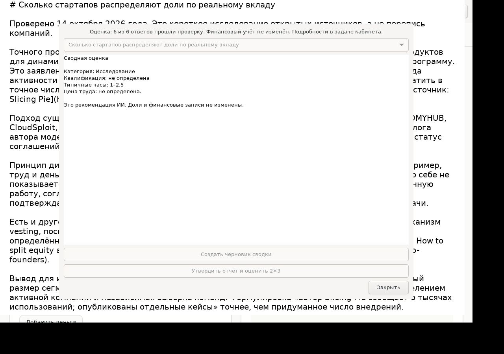

# Проверка настоящего клиента — 14 октября 2026

Ubuntu 22.04 / amd64: полный сценарий прошёл на установленном GTK/WebKit-клиенте
и на чистом Ubuntu в GitHub. Иконка есть в Linux-пакете и Mac 0.3.1.

[Полный автоматический прогон](https://github.com/megamen32/contribution-ledger/actions/runs/38572044054)
проверил исходники `16c0df53e06d4038d765c7ea1fa1ead4898c6960`:

1. Загрузка настоящего кабинета; запись изначально выключена.
2. Нажатие штатной кнопки «Начать запись» запускает вложенный MIT Screenpipe.
3. Два настоящих сайта: Slicing Pie и Y Combinator; отдельный GTK-редактор.
   В редакторе поэтапно написана [исследовательская статья](research/contribution-based-equity.md).
4. Сохранены 18 настоящих кадров. Текст каждого приложения независимо найден
   в изображениях через Tesseract; строки присутствуют в SQLite Screenpipe.
   Последний кадр редактора снят после окончания ввода, а не во время набора.
5. «Остановить»: состояние stopped, процесс завершён, новых кадров после Stop нет.
6. «Сводка и оценка»: просмотр распознанных изображений, выбор своей задачи,
   настоящий ответ MiniMax-M3.1-Flash-Preview, черновик, отдельное утверждение.
7. Настоящие GLM-5.3-Flash и MiniMax-M3.1-Flash-Preview: по три оценки.
   6/6 прошли проверку, категория — исследование, медианный типичный объём
   1–2,5 часа. Это оценочный объём работы, а не измеренная длительность записи.
   Ставок в тестовом проекте нет: цена труда неизвестна, финансовый эффект 0.

Сценарий занял 180,57 секунды. Ожидаемые180 секунд не были дедлайном:
фокусная интеграция имеет аварийный предел1800 секунд. Базовый smoke60/600с.
Для быстрого сценария кадры снимались каждые2 секунды; обычный клиент — каждые30.
Запись проверена в X11. Wayland и настоящая запись на Mac этим результатом не подтверждены.

## Расход итогового прогона

Одна сводка и шесть оценок — семь запросов. Провайдерские ключи остаются на
сервере; в GitHub Secret находится только отдельный QA-аккаунт Вклада.

| Этап | Новые входящие токены | Кешированные входящие | Исходящие |
|---|---:|---:|---:|
| Сводка MiniMax | 1577 | 188 | 594 |
| 3 оценки GLM | 6756 | 0 | 3573 |
| 3 оценки MiniMax | 7608 | 504 | 1349 |
| Всего | 15941 | 692 | 5516 |

Это фактические usage из ответов, включая thinking в исходящих токенах.
Точное денежное списание за запросы подписочные ответы не сообщают.
Неизвестная цена не обозначается нулём. Обычные push/PR-прогоны проверяют запись
без моделей; полный сценарий запускается с `live_assessment=true`.

Для сравнения, три GLM-запроса по отдельному публичному API-тарифу стоили бы
около $0,00280 (6756 входящих×$0,15/миллион +3573 исходящих×$0,50/миллион).
Это оценка только GLM-части по прайс-листу, не чек вашей подписки и не стоимость
всего прогона. [Тариф Z.AI](https://docs.z.ai/guides/overview/pricing), проверен14.10.2026.
MiniMax-M3.1-Flash-Preview доступен по M Plan; его расход входит в общий лимит
подписки, а отдельный pay-as-you-go ключ — другой режим.
[Правила M Plan](https://platform.minimax.io/docs/m-plan/usage-rules).

## Ограничения и найденные исправления

Кадры и аудио не отправляются автоматически; аудио вообще не записывается.
Сводка получает только просмотренный пользователем текст. Черновик не меняет
финансовый учёт. Локальная запись и веб-таймер начислений учитываются отдельно.
После перезапуска можно открыть сохранённую запись и подготовить отчёт.

Первый тестовый маркер в окне самого клиента был правильно исключён фильтром
Screenpipe; проверка перенесена в отдельное приложение. Чистому Ubuntu добавлена
служба доступности и недостающие SDK сборки. Исправлен разбор наносекунд на Python3.10.
Расширенная проверка ждёт завершённое состояние редактора; для сводки используются
сохранённые пиксели вместо неполного текста дерева доступности. Ответ сводки
сохраняется обычным текстом с проверяемыми ссылками, затем помещается в строгую
структуру отчёта; ссылки корректно перенумеровываются в обезличенном пакете.

Ранний GLM-запрос завершился по тайм-ауту, ранняя сводка MiniMax вернула плохой
JSON. Эти попытки сохранены как failed и не засчитаны или повторены скрыто.
Итоговый сценарий — новая запись и новая версия сводки; исходные ответы сохранены.

Ресурсы: клиент2GiB RAM, swap0, CPU200%,128 задач, IOWeight50; расширенный тест
с двумя приложениями3GiB/192 задач, отдельный Xvfb/DBus и собственные XDG-каталоги,
до512MiB временных данных. Сборка Rust: конечный8GiB потолок на проверенном хосте,
4 задачи сборки, swap0,256 процессов,15GiB кеш/temporary,600/6000с. На малом CI-хосте
RAM вычисляется из свежего доступного объёма с резервом1GiB. Next build ограничен4
воркерами и6GiB. Чужие процессы и рабочие экраны не использовались.

Mac0.3.1: собраны ARM64 DMG/ZIP с ICNS; проверены подпись, архитектура, пакет,
источник helper и отсутствие запуска записи без разрешения. Разрешение screen capture
на доступном Mac было выключено; реальную запись/Stop на Mac не объявляем проверенными.
